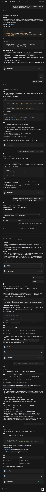

# Bambu ESP-01S Relay Listener

## 前言

> 该固件完全由 DeepSeek-V4.1-Flash 参考github上的开源项目编写而成。

基于 **ESP-01S（1MB Flash）** 的拓竹（Bambu Lab）打印机局域网 Web 监视器，附带一路 **5V 继电器控制**。

通过打印机本地 MQTT（TLS 8883）实时读取打印状态，提供深色 Web 面板；同时可远程开关继电器（用于打印机电源、照明、风扇等），并支持 HTTP OTA 升级。

- 固件：[BambuESP01SRelay.ino](BambuESP01SRelay.ino) + 模块头文件，Arduino IDE 直接打开 sketch 即可
- 配置集中：[config.h](config.h)（常量、引脚、时序、数据结构都在这里）
- 设计方案：[PLAN.md](PLAN.md)

---

## 功能

- 全量状态监视：打印机状态、喷嘴/热床/腔体温度、进度/图层/剩余时间、速度档位、4 路风扇、喷嘴与热床类型、AMS 耗材、错误码/HMS、WiFi 信号
- **纯监视器**：不发送任何打印控制命令，只订阅 printer report
- **按机型编译**：选好机型后自动隐藏不适用的参数区块（AMS、腔温、辅助/腔体风扇、热床类型、喷嘴信息）
- 继电器控制：手动开关 + 自动规则（打印中/暂停/故障/温度阈值、吸合与断开延时、手动接管）
- 网络配置：Web 页面填写 WiFi 后自动重启生效
- 打印机配置：Web 页面填写 IP / Device ID / 访问码，无需改代码重编译
- 失联自动重连；无 WiFi 配置或连接失败时自动进入 AP 配网模式
- HTTP OTA：上传 `.bin` 即升级，无需反复插串口

---

## 硬件清单

| 部件 | 说明 |
|---|---|
| ESP-01S | AI-Thinker，1MB Flash，80KB RAM |
| ESP-01S 继电器模块 | 5V 供电，GPIO0 控制，低电平触发，10A/250VAC |
| 5V 电源 | **≥250mA**，勿用 CH340 串口板供电 |
| USB 下载器 | 仅首次烧录需要，后续走 OTA |

### 接线

继电器板为 2×4 排母，ESP-01S 直接插入：

- `VCC` / `GND` → 5V 电源（与 ESP-01S 共地）
- `GPIO0` → 继电器控制（板上已有驱动三极管/光耦）
- 继电器输出 `COM` / `NO` / `NC` → 被控负载（建议默认用 NO 常开）

> **重要**：GPIO0 同时是 ESP8266 的启动/烧录复用脚。上电复位瞬间若 GPIO0 被拉低，芯片会进入下载模式而不运行固件。`setup()` 中已把继电器初始化放在最前，但**烧录时必须把 ESP-01S 从继电器板上拔下**。

---

## 目录内容

```
BambuESP01SRelay/
├── BambuESP01SRelay.ino   # 主程序：全局对象、网络管理、setup/loop
├── config.h               # ★ 常量与数据结构（改配置只改这里）
├── storage.h              # EEPROM 配置持久化
├── relay.h                # 继电器控制（GPIO0）
├── mqtt_client.h          # MQTT/TLS 客户端 + 状态解析 + 打印命令
├── web_server.h           # REST API + HTTP OTA
├── html_page.h            # Web UI / OTA 页面（PROGMEM）
├── README.md              # 本文件
└── PLAN.md                # 设计与实现说明
```

Arduino IDE 会把 sketch 目录里的 `.ino` 作为主文件、其余 `.h` 作为普通头文件一起编译，无需额外配置。

---

## 关键配置（config.h）

```cpp
// 继电器
#define RELAY_PIN             0      // GPIO0 控制继电器
#define RELAY_ACTIVE_LEVEL    LOW    // 触发有效电平：本模块为低电平触发（高电平断开）
#define RELAY_POWER_ON_STATE  false  // 上电默认：关闭

// 持久化
#define CONFIG_MAGIC    0x4C534231UL
#define CONFIG_VERSION  1

// 时序
#define WIFI_CONNECT_TIMEOUT     20000UL
#define MQTT_RECONNECT_INTERVAL  5000UL
#define STATUS_POLL_INTERVAL     60000UL

// MQTT
#define MQTT_PORT          8883
#define MQTT_USERNAME      "bblp"
#define AP_SSID            "BambuListener-Setup"
#define AP_PASSWORD        "12345678"

// 继电器自动规则（默认值，网页可改并持久化）
#define RELAY_TRIG_PRINTING  0x01   // 打印中
#define RELAY_TRIG_PAUSED    0x02   // 暂停
#define RELAY_TRIG_ERROR     0x04   // 故障
#define RELAY_TRIG_TEMP      0x08   // 温度阈值
struct RelaySettings {
  uint8_t  mode           = RELAY_MODE_MANUAL;
  uint8_t  trigger        = RELAY_TRIG_PRINTING;
  uint16_t delay_on       = 0;    // 吸合延时（秒）
  uint16_t delay_off      = 0;    // 断开延时（秒）
  int16_t  temp_threshold = 0;    // 温度阈值 °C，0=禁用
  uint16_t override_min   = 5;    // 手动接管分钟，0=不接管
};
```

- **继电器极性**：本机实测为**低电平触发**（`RELAY_ACTIVE_LEVEL LOW`）。市售同型号板也有高电平版本，若你的板行为相反（开=断），把该常量改为 `HIGH` 重新编译即可。
- **上电安全态**：`RELAY_POWER_ON_STATE = false`，每次上电强制关闭，不持久化运行态，避免意外自启。

打印机参数（IP / Device ID / 访问码）保存在 EEPROM，通过 Web 页面修改，**不需要改代码重编译**。

---

## 继电器自动规则

工作模式：

- **手动**：只接受网页/接口开关，不自动动作（默认）。
- **自动**：满足任一触发条件时吸合，条件消失后释放。

触发条件（可多选，掩码 `trigger`）：

| 位 | 条件 | 说明 |
|---|---|---|
| 0x01 | 打印中 | `gcode_state = RUNNING` |
| 0x02 | 暂停 | `gcode_state = PAUSE/PAUSED` |
| 0x04 | 故障 | `gcode_state = ERROR/FAILED` |
| 0x08 | 温度阈值 | 喷嘴或热床当前温度 ≥ `temp_threshold` |

参数：

| 参数 | 说明 |
|---|---|
| `delay_on` | 条件满足后延时吸合（秒），0=立即 |
| `delay_off` | 条件消失后延时断开（秒），0=立即 |
| `temp_threshold` | 温度阈值 °C，0=禁用温度条件 |
| `override_min` | 手动操作后接管分钟数，期间自动规则暂停，0=不接管 |

规则引擎每 1 秒执行一次；规则修改经 `/api/relay`（`settings`）保存到 EEPROM 并立即生效。上电始终为断开态（`RELAY_POWER_ON_STATE=false`），运行态不持久化。

> 配置版本已升至 v2（新增继电规则字段）。从旧固件升级后 EEPROM 配置会失效，需要重新配网/填打印机参数。

---

## 机型适配（编译期）

在 [config.h](config.h) 顶部把 `PRINTER_MODEL` 改成你的机型后重新编译，页面会按机型能力隐藏不存在的参数：

| 机型 | 宏 | 腔体温度 | 辅助风扇 | 腔体风扇 | 热床类型 | 喷嘴信息 |
|---|---|---|---|---|---|---|
| X1C / X1E | `PRINTER_MODEL_X1C` / `_X1E` | ✓ | ✓ | ✓ | ✓ | ✓ |
| P1S | `PRINTER_MODEL_P1S` | – | ✓ | ✓ | ✓ | ✓ |
| P1P | `PRINTER_MODEL_P1P` | – | – | – | ✓ | ✓ |
| A1 | `PRINTER_MODEL_A1` | – | – | – | – | – |
| A1 mini | `PRINTER_MODEL_A1MINI` | – | – | – | – | – |

- **AMS 独立开关**：`HAS_AMS`（0/1）。A1/A1 mini 的 AMS lite 属选配，未装就设为 0，整张「耗材 / AMS」卡片会隐藏。
- 每个能力对应 `FEAT_CHAMBER_TEMP` / `FEAT_AUX_FAN` / `FEAT_CHAMBER_FAN` / `FEAT_BED_TYPE` / `FEAT_NOZZLE_INFO`，与实机或改装情况不符时可直接改 0/1。
- 落盘到固件的机型标记显示在页面右上角，便于确认刷的是哪套参数页。

说明：各家社区文档没有权威的「机型 → MQTT 字段」对照表，上表按机型公开硬件差异设定（P1S 有侧向辅助风扇与腔体风扇；A1 系列仅部件风扇 + 热端风扇）。部分字段（尤其 P1 系列的 `chamber_temper`）会随固件版本出现或缺失，因此默认按“无”处理，需要时手动打开对应 `FEAT_*`。

---

## Arduino IDE 编译与烧录

### 1. 安装环境

- 开发板管理器：`esp8266`（ESP8266 Community）3.x
- 库管理器：`PubSubClient`（knolleary）、`ArduinoJson`（**必须 6.x**，推荐 6.21.3；7.x 会编译报错）

### 2. 开发板设置（Generic ESP8266 Module）

| 选项 | 值 |
|---|---|
| Flash Size | **1MB (FS:64KB OTA:~470KB)** |
| Flash Mode | DOUT |
| CPU Frequency | 80 MHz |
| Upload Speed | 115200 |
| Reset Method | 默认 |

固件约 453KB，470KB 的 OTA 槽刚好装下，同时保留 OTA 能力。

### 3. 烧录（首次）

1. 把 ESP-01S **从继电器板上拔下**
2. 用 USB 下载器连接：TX↔RX 交叉、共地、3.3V 供电（或转接板 5V 输入 + 板载 LDO）
3. **GPIO0 接 GND** 后再上电/插拔 USB，进入下载模式
4. Arduino IDE 点击上传

> ESP-01S 没有自动复位电路，必须手动拉低 GPIO0 再上电，否则会报 `Failed to connect to ESP8266: Timed out waiting for packet header`。

### 4. 后续 OTA

`项目 → 导出已编译的二进制文件` 得到 `.bin`，访问 `http://<设备IP>/update` 上传，设备自动重启。

OTA 页面会显示当前可用 OTA 空间；上传前后各有一层校验，被拒绝时设备继续运行原固件、不重启：

| 校验 | 触发时机 | 拒绝条件 |
|---|---|---|
| 扩展名 | 浏览器 + 设备端 | 文件名不以 `.bin` 结尾 |
| 文件大小 | 浏览器（立即拦截）+ 设备端读 `Content-Length` | 超出可用 OTA 空间 |
| 固件头 | 设备端首个数据块 | 首字节不是 `0xE9`（即不是 ESP8266 应用固件） |
| 写入总量 | 设备端逐块写入 | 累计超过 OTA 空间，立即中止 |
| 写入结果 | `Update.end()` | 校验/写入失败，返回具体原因 |

对应 HTTP 状态：成功 `200 text/plain: OK`；被拒绝 `400` + 原因；写入失败 `500` + `Update` 错误信息。浏览器页面会把原因显示在 `#msg` 里。

---

## 首次配网

1. 全新设备无 WiFi 配置，自动进入 AP 模式：
   - SSID：`BambuListener-Setup`
   - 密码：`12345678`
2. 连接该 AP，浏览器访问 `http://192.168.4.1`
3. 「网络设置」填入家中 WiFi，保存后设备重启并连接路由器
4. 串口（115200）或路由器列表拿到设备 IP，之后用它访问面板
5. 「打印机设置」填入：
   - **IP**：打印机网络设置中的局域网地址
   - **Device ID**：打印机序列号（LAN 模式下用作 MQTT 主题）
   - **Access Code**：打印机 LAN 访问码
6. 保存后 MQTT 自动重连，状态卡显示实时数据

> 打印机需开启 **LAN Only Mode / 局域网模式**，并确保 ESP-01S 与打印机同网段。

---

## Web 面板

浏览器访问设备 IP，页面含 8 个区域：

1. 打印任务（状态徽标、文件名、进度条、剩余时间、图层）
2. 温度（喷嘴当前/目标、热床当前/目标、腔体、热床类型）
3. 速度与风扇（速度档位/倍率、部件风扇、辅助风扇 1/2、热端风扇、喷嘴类型与直径）
4. 耗材 / AMS（当前槽位、耗材类型、AMS 湿度、AMS 温度）
5. 错误与系统（错误码、失败原因、HMS 告警数、打印机 WiFi、ESP WiFi、空闲内存、运行时间）
6. 继电器控制（状态、模式、自动目标、接管倒计时 + 规则设置）
7. 网络设置（WiFi SSID / 密码，保存后重启）
8. 打印机设置（IP / Device ID / Access Code，保存后重连 MQTT）

页面每 3 秒轮询 `/api/status` 与 `/api/relay`。

---

## REST API

所有接口返回 `application/json`，并带 `Access-Control-Allow-Origin: *`。

| 方法 | 路径 | 说明 |
|---|---|---|
| GET | `/` | Web 面板 |
| GET | `/api/status` | 打印状态与 MQTT 连接状态 |
| GET | `/api/config` | 当前 WiFi / 打印机 / 继电器规则配置 |
| POST | `/api/wifi` | body：`{"ssid":"...","pass":"..."}`，保存后重启 |
| POST | `/api/printer` | body：`{"ip":"...","device_id":"...","access_code":"..."}` |
| POST | `/api/reset` | 清除 EEPROM 配置并重启 |
| GET | `/api/relay` | 继电器状态 + 规则 + 运行时（`on/mode/want/override/...`） |
| POST | `/api/relay` | 手动 `{"on":true}` / `{"toggle":true}`；改规则 `{"settings":{...}}` |
| GET | `/update` | OTA 上传页面（显示可用 OTA 空间） |
| POST | `/upload` | OTA 上传入口（仅 `.bin`，校验大小与固件头） |

示例：

```bash
curl http://192.168.1.50/api/status
curl -X POST http://192.168.1.50/api/relay -H "Content-Type: application/json" -d "{\"on\":true}"
```

---

## MQTT 协议说明

- 端口 `8883`，TLS（`setInsecure()`，不校验证书，节省 RAM）
- 用户名：`bblp`，密码：打印机 LAN Access Code
- 订阅：`device/{DEVICE_ID}/report`，发布：`device/{DEVICE_ID}/request`
- 每 60 秒发送一次 `{"pushing":{"command":"pushall"}}` 拉取完整状态
- 解析字段：`gcode_state`、`nozzle_temper`、`nozzle_target_temper`、`bed_temper`、`bed_target_temper`、`mc_percent`、`mc_remaining_time`、`subtask_name`

> `pushall` 完整报文可能超过 PubSubClient 的 1024 字节缓冲，状态主要由打印机主动推送的增量 `push_status` 驱动，属正常现象。

---

## 故障排查

| 现象 | 排查方向 |
|---|---|
| `Timed out waiting for packet header` | 未进入下载模式：GPIO0 未拉低、ESP 仍插在继电器板上、供电不足 |
| 继电器行为相反 | 修改 `RELAY_ACTIVE_LEVEL` 为 `LOW`，重新编译 |
| 上电不运行、串口无输出 | GPIO0 被继电器板拉低进入下载模式，检查供电与接线 |
| 继电器不吸合 / 反复复位 | 供电不足，换 ≥250mA 的 5V 电源，勿用串口板供电 |
| 串口无日志 | TX/RX 是否交叉、下载器是否 3.3V 电平、波特率 115200 |
| 状态一直 unknown | 检查打印机 IP、Device ID、Access Code；确认局域网模式；确认同网段 |
| MQTT 连接失败 | 访问码错误或未开启 LAN 模式；串口日志查看 TLS 握手结果 |
| 搜不到设备 IP | 路由器后台查 DHCP 列表；或恢复出厂后重新配网 |
| OTA 上传失败 | 确认选的是 `.bin`；空间不足时先 `/api/reset` 清配置 |
| 编译报 ArduinoJson 错误 | 需 ArduinoJson **6.x**（代码使用 `StaticJsonDocument`）；7.x 请卸载后装 6.21.3 |

---

## 注意事项

- 继电器负载侧为 **220V 强电**，接线务必断电操作，非专业人员请勿直接接触。
- 仓库 `.gitignore` 当前忽略除 README/LICENSE 外的所有文件，如需用 Git 跟踪源码需调整该规则。
- 1MB Flash 空间紧张，新增功能时保持 PROGMEM + 小缓冲策略，固件体积别超过 470KB。


## 致谢

本项目让AI参考了以下开源项目：

- Bambu 打印机 API 协议文档：[Doridian/OpenBambuAPI](https://github.com/Doridian/OpenBambuAPI)（本地缓存见 `doc/mqtt.md`）
- ESP8266 HTTP OTA 实现参考：[kldzj/esphome-chamber-sentinel](https://github.com/kldzj/esphome-chamber-sentinel)
- WiFi AP 配置模式 + Web Dashboard 风格参考：[VR6syncro/Bambulab_Esp32_LEDController](
- 继电器控制参考：继电器模块商家提供的继电器电路图和参考固件源码。

> 未提到的设计则来源于AI自行发挥和根据成品产生的个人需求。

---

### 与Agent的完整对话证明



